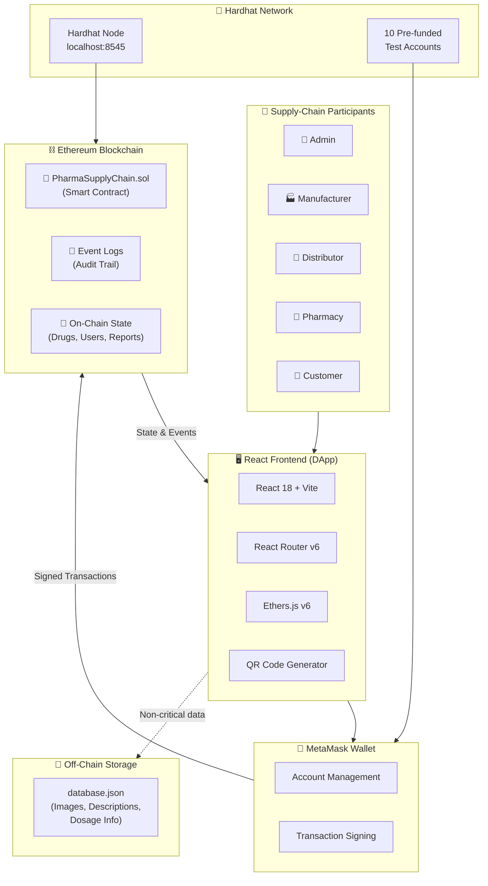
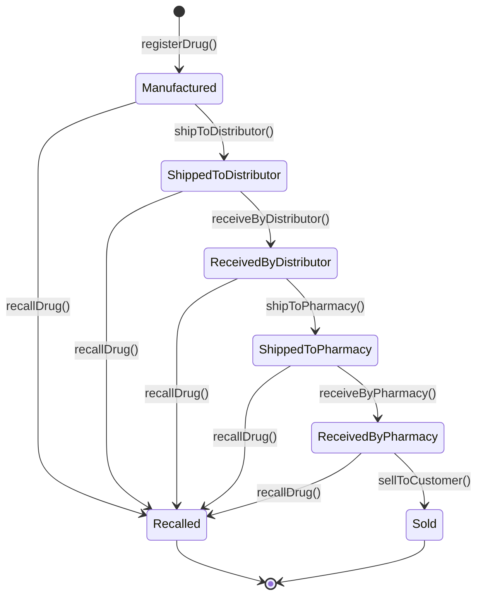
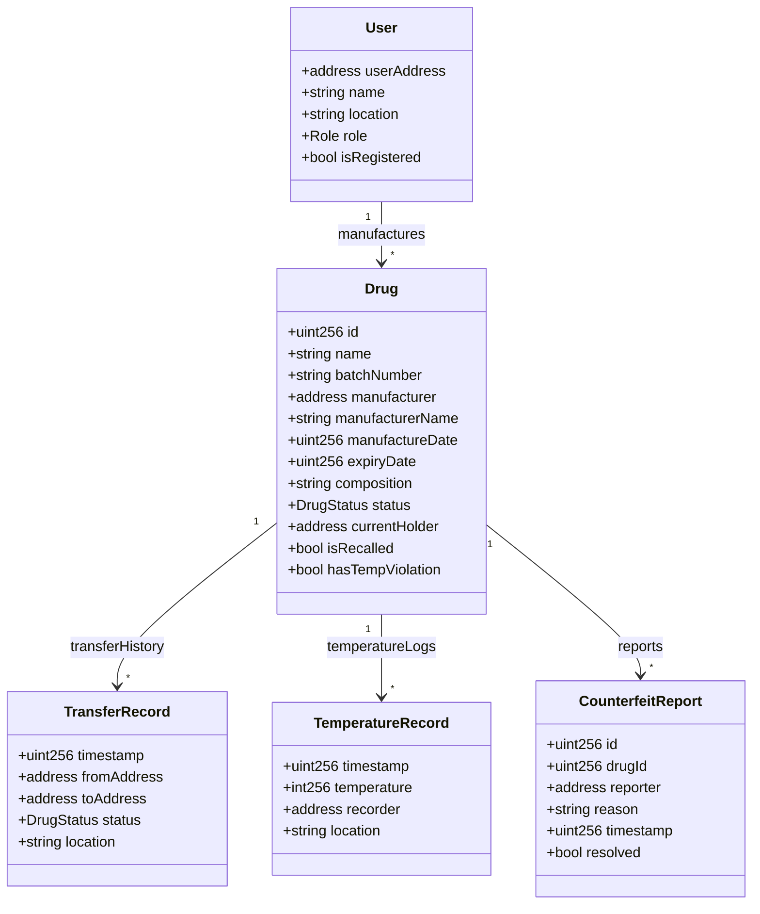

# 🔗 PharmaChain: Blockchain-Based Pharmaceutical Supply-Chain Traceability & Anti-Counterfeit System


> A decentralized application (DApp) that leverages Ethereum blockchain technology to create a **tamper-proof, transparent pharmaceutical supply chain** — from the manufacturer's production floor to the customer's hands.

---

## 📋 Table of Contents

- [Problem Statement](#-problem-statement)
- [Proposed Solution](#-proposed-solution)
- [System Architecture](#-system-architecture)
- [Blockchain Concepts Demonstrated](#-blockchain-concepts-demonstrated)
- [Smart Contract Design](#-smart-contract-design)
- [Data Management (On-Chain vs Off-Chain)](#-data-management-on-chain-vs-off-chain)
- [Security & Privacy](#-security--privacy)
- [Tech Stack](#-tech-stack)
- [Installation & Setup](#-installation--setup)
- [Testing](#-testing)
- [Project Structure](#-project-structure)
- [Screenshots](#-screenshots)
- [Team / Credits](#-team--credits)
- [License](#-license)

---

## 🚨 Problem Statement

The global pharmaceutical supply chain is riddled with critical vulnerabilities that endanger millions of lives every year:

| Problem | Impact |
|---------|--------|
| **Counterfeit Drugs** | The WHO estimates that **~1 million deaths per year** are caused by counterfeit or substandard medicines, particularly in low- and middle-income countries. |
| **Opaque Supply Chains** | Multi-layered supply chains involving manufacturers, distributors, re-packagers, and pharmacies create blind spots where counterfeit drugs can be introduced undetected. |
| **No Tamper-Proof Audit Trail** | Paper-based and centralized digital records can be **altered, forged, or destroyed** — leaving regulators and consumers with no reliable way to trace a drug's journey. |
| **Cold-Chain Failures** | Temperature-sensitive drugs (vaccines, biologics, insulin) **spoil silently** during transit when cold-chain conditions are violated, with no automatic flagging mechanism. |
| **Lack of Consumer Verification** | End consumers have **no easy, trustworthy way** to independently verify whether the medicine they are purchasing is authentic and safe. |

> **Bottom line:** The pharmaceutical industry needs a system where every handoff is immutably recorded, every participant is authenticated, and anyone can independently verify a drug's authenticity — without relying on a single centralized authority that can be compromised.

---

## 💡 Proposed Solution

**PharmaChain** addresses these challenges by deploying a smart-contract-powered decentralized application on the Ethereum blockchain:

1. **Immutable, Transparent Tracking** — Every supply-chain event (manufacture, shipment, receipt, sale) is recorded as an on-chain transaction that **cannot be altered or deleted**. The blockchain acts as a single source of truth shared by all participants.

2. **Smart Contract Enforcement** — Business rules are encoded directly into the `PharmaSupplyChain` smart contract. Role-based access control, sequential status transitions, and expiry-date checks are enforced **automatically** — no middleman, no manual oversight required.

3. **Elimination of Single Points of Trust** — Unlike centralized databases controlled by one organization, the blockchain is maintained by a distributed network. No single actor can tamper with the records without detection.

4. **Cold-Chain Temperature Monitoring** — Authorized holders record temperature readings on-chain. If a reading falls outside the safe range (2–8 °C for vaccines/biologics), the contract **automatically flags a violation** and emits an alert event — providing an immutable record of cold-chain integrity.

5. **Counterfeit Reporting & Drug Recall** — Anyone can file a counterfeit report on-chain. Admins and manufacturers can **recall drugs instantly**, blocking all further transfers and sales of the affected batch.

6. **Consumer Verification** — End customers can verify a drug's authenticity by its **Drug ID** or **Batch Number**, receiving a comprehensive report of its manufacture date, expiry, recall status, temperature history, and full chain of custody.

---

## 🏗 System Architecture



### How It Works

1. **Users** interact with the **React DApp** through role-specific dashboards.
2. The DApp uses **Ethers.js** to communicate with the smart contract via **MetaMask**.
3. MetaMask prompts the user to **sign each transaction** with their private key.
4. The signed transaction is sent to the **Hardhat local blockchain** (or any Ethereum-compatible network).
5. The **smart contract** validates the transaction against its rules (role checks, status transitions, expiry dates) and updates state.
6. **Events** are emitted for every state change, creating a tamper-proof audit trail.
7. **Off-chain data** (images, detailed descriptions) is stored in a local JSON file to minimize gas costs.

---

## 🧱 Blockchain Concepts Demonstrated

This project serves as a practical demonstration of fundamental blockchain concepts. Each concept is mapped to a concrete implementation within PharmaChain:

### 1. Distributed Ledger

> *A shared, synchronized database maintained across multiple nodes with no central administrator.*

**In PharmaChain:** When the Hardhat node runs, it simulates a blockchain where every supply-chain record (drugs, transfers, users) is stored in a shared ledger. In a production deployment, this ledger would be replicated across thousands of Ethereum nodes worldwide. No single organization — not the manufacturer, not the distributor — controls the data. Every participant reads from the **same immutable ledger**.

### 2. Blocks & Transactions

> *Transactions are grouped into blocks; each block references the previous block via its hash, forming an ordered chain.*

**In PharmaChain:** Each action — registering a drug, shipping it, recording a temperature — becomes an Ethereum **transaction** that is mined into a **block** on the Hardhat network. The `block.timestamp` is used extensively (e.g., `manufactureDate`, expiry checks, transfer records) to anchor each event to a specific point in time on the blockchain.

### 3. Cryptographic Hashing

> *A one-way function that maps data of any size to a fixed-size digest; any change in input produces a completely different hash.*

**In PharmaChain:** Every block on the chain is secured by its cryptographic hash (Keccak-256 on Ethereum). The `batchToDrugId` mapping uses the batch number string, which is internally hashed by the EVM for storage slot calculation. Transaction hashes uniquely identify every supply-chain action, making it trivial to audit any individual event.

### 4. Consensus Mechanism (PoA on Hardhat)

> *The protocol by which nodes agree on the next valid block, preventing double-spending and fraudulent records.*

**In PharmaChain:** The Hardhat local network uses **Proof of Authority (PoA)** consensus — a single authorized node (the Hardhat node) validates and mines blocks instantly. This is ideal for development and testing. On Ethereum mainnet, the contract would be secured by **Proof of Stake (PoS)** consensus, where thousands of validators stake ETH to secure the network.

### 5. Immutability

> *Once data is written to the blockchain, it cannot be altered or deleted.*

**In PharmaChain:** This is the core anti-counterfeit property. Once `registerDrug()` records a drug or `_recordTransfer()` logs a handoff, that record is **permanent**. Even the contract owner cannot edit past transfer records. The `transferHistory` mapping is append-only — records can be added but never modified or deleted. If a drug is recalled, a *new* record is appended (with `DrugStatus.Recalled`); the original history remains intact for auditing.

### 6. Smart Contracts

> *Self-executing programs stored on the blockchain that automatically enforce agreed-upon rules without intermediaries.*

**In PharmaChain:** The `PharmaSupplyChain.sol` contract is the heart of the system. It encodes:
- **Role-based access** (`onlyManufacturer`, `onlyDistributor`, etc.) — only authorized participants can perform specific actions.
- **State machine transitions** — a drug *must* follow the sequence Manufactured → Shipped → Received → Sold; skipping steps is impossible.
- **Business logic** — expired drugs cannot be sold (`block.timestamp < drug.expiryDate`), recalled drugs cannot be transferred (`notRecalled` modifier), and cold-chain violations are automatically flagged.

### 7. Events (Audit Trail)

> *Logs emitted by smart contracts that are stored in the blockchain's transaction receipts — readable by off-chain applications but not by other contracts.*

**In PharmaChain:** Seven events create a comprehensive audit trail:

| Event | When Emitted | Purpose |
|-------|-------------|---------|
| `UserRegistered` | Admin registers a participant | Track who joined the network |
| `DrugRegistered` | Manufacturer creates a new drug | Record drug creation with metadata |
| `DrugTransferred` | Any supply-chain handoff | Track every custody change |
| `TemperatureRecorded` | Holder logs temperature | Monitor cold-chain compliance |
| `TemperatureViolation` | Reading outside 2–8 °C range | Automatic safety alert |
| `DrugRecalled` | Admin/manufacturer recalls a drug | Immediate network-wide notification |
| `CounterfeitReported` | Anyone files a suspicious report | Crowdsourced integrity monitoring |

The React frontend listens for these events to provide **real-time notifications and historical audit logs**.

---

## 📜 Smart Contract Design

### Contract Overview

| Property | Detail |
|----------|--------|
| **Contract Name** | `PharmaSupplyChain` |
| **Solidity Version** | `^0.8.20` |
| **License** | MIT (SPDX) |
| **Optimizer** | Enabled, 200 runs |

### Roles & Access Control

The contract implements **role-based access control** through Solidity `modifier`s and the `Role` enum:

| Role | Enum Value | Capabilities |
|------|------------|-------------|
| `None` | 0 | Unregistered — no access |
| `Admin` | 1 | Register users, recall drugs, resolve counterfeit reports |
| `Manufacturer` | 2 | Register drugs, ship to distributors, recall own drugs, record temperatures |
| `Distributor` | 3 | Receive shipments, ship to pharmacies, record temperatures |
| `Pharmacy` | 4 | Receive shipments, sell to customers, record temperatures |
| `Customer` | 5 | Report counterfeits, verify drugs |

**Modifiers** enforce these roles at the function level:

```solidity
modifier onlyAdmin()        // Restricts to Role.Admin
modifier onlyManufacturer() // Restricts to Role.Manufacturer
modifier onlyDistributor()  // Restricts to Role.Distributor
modifier onlyPharmacy()     // Restricts to Role.Pharmacy
modifier onlyRegistered()   // Restricts to any registered user
modifier drugExists(id)     // Validates the drug ID is valid
modifier notRecalled(id)    // Blocks operations on recalled drugs
```

### Key Functions

| Function | Access | Description |
|----------|--------|-------------|
| `registerUser()` | Admin | Register a new supply-chain participant with role |
| `registerDrug()` | Manufacturer | Create a new drug record with batch number, composition, and expiry |
| `shipToDistributor()` | Manufacturer | Ship drug from manufacturer to distributor |
| `receiveByDistributor()` | Distributor | Confirm receipt of drug shipment |
| `shipToPharmacy()` | Distributor | Ship drug from distributor to pharmacy |
| `receiveByPharmacy()` | Pharmacy | Confirm receipt of drug at pharmacy |
| `sellToCustomer()` | Pharmacy | Sell drug to end customer (checks expiry) |
| `recordTemperature()` | Current Holder | Log cold-chain temperature reading |
| `recallDrug()` | Admin / Manufacturer | Pull drug from supply chain |
| `reportCounterfeit()` | Anyone | File a counterfeit suspicion report |
| `resolveReport()` | Admin | Mark a counterfeit report as resolved |
| `verifyDrug()` | Anyone (view) | Check drug authenticity, recall status, expiry, temperature violations |
| `verifyByBatch()` | Anyone (view) | Look up drug by batch number |
| `getDrugHistory()` | Anyone (view) | Retrieve full chain-of-custody audit trail |
| `getTemperatureLogs()` | Anyone (view) | Retrieve all temperature readings for a drug |

### State Machine — Drug Status Transitions

The `DrugStatus` enum defines a strict state machine. Each transition is enforced by `require` statements in the corresponding function:



> **Key constraint:** A drug can be **recalled from any active state** by the admin or the original manufacturer. Once recalled, all transfer and sale functions are blocked by the `notRecalled` modifier.

### Data Structures



---

## 💾 Data Management (On-Chain vs Off-Chain)

A well-designed DApp stores only **critical, integrity-sensitive** data on-chain (where it is immutable and transparent) and keeps **non-critical supplementary data** off-chain (where it is cheaper and more flexible).

| Data | Storage | Justification |
|------|---------|---------------|
| Drug ID & batch number | ⛓️ On-chain | Unique identifiers — must be tamper-proof for verification |
| Drug status & transitions | ⛓️ On-chain | Core supply-chain state — integrity is paramount |
| Current holder address | ⛓️ On-chain | Proves custody — critical for accountability |
| Manufacture & expiry dates | ⛓️ On-chain | Safety-critical timestamps — must be immutable |
| Drug composition | ⛓️ On-chain | Authenticity verification data |
| Transfer history (audit trail) | ⛓️ On-chain | Tamper-proof provenance chain — the core value proposition |
| Temperature readings | ⛓️ On-chain | Cold-chain compliance evidence — must be unforgeable |
| Counterfeit reports | ⛓️ On-chain | Safety reports — must be permanent and attributable |
| User roles & addresses | ⛓️ On-chain | Access control — enforced by smart contract |
| Drug images | 📂 Off-chain JSON | Large binary data — too expensive to store on-chain |
| Detailed descriptions | 📂 Off-chain JSON | Supplementary text — not critical for integrity |
| Dosage instructions | 📂 Off-chain JSON | Reference information — can be updated without blockchain tx |
| Side effects & storage info | 📂 Off-chain JSON | Regulatory text — frequently updated, no integrity dependency |
| User profile pictures | 📂 Off-chain JSON | Non-critical metadata |
| System configuration | 📂 Off-chain JSON | Application settings — not part of the trust model |

> 📁 See [`offchain/README.md`](offchain/README.md) for details on the off-chain storage strategy and how `database.json` can be replaced with a production database.

---

## 🔐 Security & Privacy

### Role-Based Access Control (RBAC)

The smart contract implements RBAC through Solidity `modifier`s. Every state-changing function is protected:

- **`onlyAdmin`** — User registration, report resolution
- **`onlyManufacturer`** — Drug registration, shipping to distributors
- **`onlyDistributor`** — Receiving from manufacturers, shipping to pharmacies
- **`onlyPharmacy`** — Receiving from distributors, selling to customers
- **`onlyRegistered`** — Temperature recording (any registered participant)
- **`drugExists`** — Validates target drug ID before any operation
- **`notRecalled`** — Prevents any transfer of recalled drugs

### Address-Based Authentication

- Participants are identified by their **Ethereum address** (public key).
- **MetaMask** signs every transaction with the user's private key, providing cryptographic proof of identity.
- No username/password system needed — the blockchain itself is the authentication layer.

### Data Integrity

- All critical supply-chain data is stored **immutably on-chain**.
- The `transferHistory` array is **append-only** — once a transfer is recorded, it can never be modified.
- Events provide a secondary, independently verifiable audit trail stored in transaction receipts.

### Privacy Considerations

- **No sensitive patient data** is stored on-chain — no names, medical records, or prescription details.
- On-chain data is limited to **operational supply-chain information** (drug metadata, holder addresses, timestamps).
- User names and locations stored on-chain are **business entity names** (e.g., "PharmaCorp India Pvt Ltd"), not personal patient data.

### Smart Contract Safety

- Uses Solidity `^0.8.20` which has **built-in overflow/underflow protection**.
- `require` statements provide descriptive error messages for every failure condition.
- No `selfdestruct`, no `delegatecall`, no external contract calls — minimizing attack surface.
- Optimizer enabled at 200 runs for balanced gas efficiency and code safety.

---

## ⚙️ Tech Stack

| Technology | Version | Purpose |
|------------|---------|---------|
| **Solidity** | ^0.8.20 | Smart contract programming language |
| **Hardhat** | ^2.19.0 | Ethereum development environment (compile, test, deploy) |
| **Ethers.js** | ^6.9.0 | Blockchain interaction library for the frontend |
| **React** | ^18.2.0 | Frontend user interface framework |
| **Vite** | ^5.0.8 | Fast frontend build tool and dev server |
| **React Router** | ^6.21.0 | Client-side routing for role-based dashboards |
| **MetaMask** | Latest | Browser wallet for transaction signing |
| **Chai** | (via Hardhat Toolbox) | Assertion library for smart contract tests |
| **Mocha** | (via Hardhat Toolbox) | Test runner framework |
| **react-hot-toast** | ^2.4.1 | Toast notifications for transaction feedback |
| **qrcode.react** | ^3.1.0 | QR code generation for drug verification |
| **Node.js** | ≥16.0 | Runtime environment |

---

## 🚀 Installation & Setup

### Prerequisites

- [Node.js](https://nodejs.org/) (v16 or later)
- [MetaMask](https://metamask.io/) browser extension
- [Git](https://git-scm.com/)

### Step-by-Step Guide

> ⚡ **Quick 1-Click Launch (Recommended for Demos)**:
> Simply double-click **`start-demo.bat`** (or execute `.\start-demo.ps1` in PowerShell). It automatically spawns the local Ethereum node, deploys & seeds the smart contract, spins up the React frontend, and opens `http://localhost:5173` in your browser!

#### Manual Step-by-Step Instructions:

```bash
git clone https://github.com/your-username/pharma-supply-chain.git
cd pharma-supply-chain
```

#### 2. Install Smart Contract Dependencies

```bash
npm install
```

This installs Hardhat, Hardhat Toolbox (Chai, Mocha, Ethers.js), and all Solidity compilation tools.

#### 3. Compile the Smart Contract

```bash
npx hardhat compile
```

This compiles `PharmaSupplyChain.sol` and generates the ABI and bytecode in the `artifacts/` directory.

#### 4. Start the Local Blockchain (Terminal 1)

```bash
npx hardhat node
```

This starts a local Hardhat network at `http://127.0.0.1:8545` with **10 pre-funded test accounts** (10,000 ETH each). **Keep this terminal running.**

You will see output like:
```
Started HTTP and WebSocket JSON-RPC server at http://127.0.0.1:8545/

Accounts
========
Account #0: 0xf39Fd6...  (10000 ETH)
Private Key: 0xac0974bec39...
Account #1: 0x70997970...  (10000 ETH)
Private Key: 0x59c6995e99...
...
```

#### 5. Deploy the Smart Contract (Terminal 2)

```bash
npx hardhat run scripts/deploy.js --network localhost
```

The deployment script will:
- Deploy the `PharmaSupplyChain` contract
- Register 4 supply-chain participants (Manufacturer, Distributor, Pharmacy, Customer)
- Register a sample drug (Paracetamol 500mg)
- Save the contract address and ABI to `frontend/src/contractData.json`

#### 6. Start the React Frontend (Terminal 3)

```bash
cd frontend
npm install
npm run dev
```

The Vite dev server will start at `http://localhost:5173`.

#### 7. Configure MetaMask

1. Open MetaMask and click **Add Network** → **Add a network manually**
2. Enter the following details:

| Field | Value |
|-------|-------|
| Network Name | Hardhat Localhost |
| RPC URL | `http://127.0.0.1:8545` |
| Chain ID | `31337` |
| Currency Symbol | ETH |

3. Click **Save** and switch to the **Hardhat Localhost** network.

#### 8. Import Test Accounts into MetaMask

Copy the **private keys** from the Hardhat node output (Step 4) and import them into MetaMask:

| Account | Role | Use Private Key From |
|---------|------|---------------------|
| Account #0 | Admin | Hardhat Account #0 |
| Account #1 | Manufacturer | Hardhat Account #1 |
| Account #2 | Distributor | Hardhat Account #2 |
| Account #3 | Pharmacy | Hardhat Account #3 |
| Account #4 | Customer | Hardhat Account #4 |

In MetaMask: **Click profile icon → Import Account → Paste Private Key → Import**

> ⚠️ **Important:** These are **test accounts** with fake ETH. Never use these private keys on a real network.

---

## 🧪 Testing

### Running Tests

```bash
npx hardhat test
```

### Test Coverage

The test suite contains **30 tests** organized across **10 categories**:

| # | Category | Tests | What's Covered |
|---|----------|-------|---------------|
| 1 | **Deployment** | 2 | Admin/owner initialization, counter values |
| 2 | **User Registration** | 4 | Correct role assignment, duplicate rejection, non-admin rejection, invalid roles, event emission |
| 3 | **Drug Registration** | 5 | Manufacturer registration, non-manufacturer rejection, duplicate batch rejection, empty name/batch rejection, past expiry rejection, event emission |
| 4 | **Full Supply-Chain Flow** | 3 | Complete Manufacturer → Distributor → Pharmacy → Customer path, audit trail construction, event emission at each step |
| 5 | **Invalid Transitions** | 4 | Skip-step rejection, wrong-role rejection, non-holder rejection, wrong-recipient rejection |
| 6 | **Temperature Monitoring** | 4 | Safe range recording, above-8°C violation, below-2°C violation, non-holder rejection |
| 7 | **Drug Recall** | 5 | Admin recall, manufacturer recall, transfer-after-recall block, sale-after-recall block, unauthorized recall rejection, event emission |
| 8 | **Counterfeit Reporting** | 4 | Report creation, empty-reason rejection, admin resolution, event emission |
| 9 | **Drug Verification** | 5 | Authentic drug verification, batch lookup, non-existent batch, recalled drug authentication, non-existent ID rejection |
| 10 | **Edge Cases & Security** | 4 | Unregistered user rejection, non-existent drug operations, user count validation, user list retrieval |

### Sample Test Output

```
  PharmaSupplyChain
    Deployment
      ✔ Should set deployer as admin / owner
      ✔ Should initialise counters to correct values
    User Registration
      ✔ Should register users with correct roles and metadata
      ✔ Should reject duplicate registration
      ✔ Should reject registration by non-admin
      ✔ Should reject invalid roles (None=0, Admin=1)
      ✔ Should emit UserRegistered event
    Drug Registration
      ✔ Should register a drug by manufacturer
      ✔ Should reject registration by non-manufacturer
      ✔ Should reject duplicate batch numbers
      ✔ Should reject empty name or batch number
      ✔ Should reject expiry date in the past
      ✔ Should emit DrugRegistered event
    Supply Chain – Full Flow
      ✔ Should complete Manufacturer → Distributor → Pharmacy → Customer
      ✔ Should build a complete transfer history (audit trail)
      ✔ Should emit DrugTransferred at each step
    Supply Chain – Invalid Transitions
      ✔ Should reject ship-to-pharmacy before distributor receives
      ✔ Should reject sell-to-customer before pharmacy receives
      ✔ Should reject transfer by wrong role
      ✔ Should reject transfer by non-holder
      ✔ Should reject sending to wrong role recipient
    Temperature Monitoring
      ✔ Should record temperature within safe range (no violation)
      ✔ Should flag temperature violation above 8 °C
      ✔ Should flag temperature violation below 2 °C
      ✔ Should reject recording by non-holder
    Drug Recall
      ✔ Should allow admin to recall a drug
      ✔ Should allow manufacturer to recall own drug
      ✔ Should prevent recalled drug from being transferred
      ✔ Should prevent recalled drug from being sold
      ✔ Should reject recall by unauthorized user
      ✔ Should emit DrugRecalled event
    Counterfeit Reporting
      ✔ Should accept a counterfeit report from anyone
      ✔ Should reject empty reason
      ✔ Should allow admin to resolve report
      ✔ Should emit CounterfeitReported event
    Drug Verification
      ✔ Should verify an authentic (non-recalled, non-expired) drug
      ✔ Should look up drug by batch number
      ✔ Should return false for non-existent batch
      ✔ Should report recalled drug as not authentic
      ✔ Should reject verification for non-existent drug ID
    Edge Cases & Security
      ✔ Should not allow unregistered user to record temperature
      ✔ Should handle operations on non-existent drugs
      ✔ Should correctly count registered users
      ✔ Should return users list

  30 passing
```

---

## 📁 Project Structure

```
pharma-supply-chain/
├── contracts/
│   └── PharmaSupplyChain.sol       # Main smart contract (645 lines)
├── scripts/
│   └── deploy.js                   # Deployment + seed data script
├── test/
│   └── PharmaSupplyChain.test.js   # Comprehensive test suite (30 tests)
├── frontend/
│   ├── src/
│   │   └── contractData.json       # Auto-generated after deployment (ABI + address)
│   └── package.json                # Frontend dependencies (React, Vite, Ethers.js)
├── offchain/
│   ├── database.json               # Sample off-chain data store
│   └── README.md                   # Off-chain data documentation
├── docs/
│   └── ARCHITECTURE.md             # Deep-dive architecture documentation
├── .env.example                    # Environment variable template
├── hardhat.config.js               # Hardhat configuration (Solidity 0.8.20, optimizer)
├── package.json                    # Root dependencies (Hardhat, Hardhat Toolbox)
└── README.md                       # This file
```

---

## 📸 Screenshots

> [!NOTE]
> **Screenshots Placeholder** — Add screenshots after running the application.

### Dashboard Views

- [ ] **Admin Dashboard** — User registration, drug recall, counterfeit report management
- [ ] **Manufacturer Dashboard** — Drug registration, shipping interface, temperature logging
- [ ] **Distributor Dashboard** — Receive shipments, forward to pharmacies, cold-chain monitoring
- [ ] **Pharmacy Dashboard** — Receive inventory, sell to customers, verification tools
- [ ] **Customer View** — Drug verification page with QR code scanner

### Key Workflows

- [ ] **Drug Registration Flow** — Manufacturer creating a new drug batch
- [ ] **Supply Chain Transfer** — Drug moving through each stage with status updates
- [ ] **Temperature Monitoring** — Cold-chain readings and violation alerts
- [ ] **Drug Verification** — Customer verifying drug authenticity
- [ ] **Recall Process** — Admin recalling a drug and seeing it blocked from further transfer

---

## 👥 Team / Credits

> *Add your team members here.*

| Name | Role | Contribution |
|------|------|-------------|
| | | Smart contract development |
| | | Frontend development |
| | | Testing & documentation |
| | | Architecture & design |

### Acknowledgments

- [OpenZeppelin](https://openzeppelin.com/) — for best practices in smart contract security
- [Hardhat](https://hardhat.org/) — for the exceptional Ethereum development environment
- [Ethereum Foundation](https://ethereum.org/) — for the underlying blockchain platform
- [WHO](https://www.who.int/) — for research on counterfeit medicines that motivated this project

---

## 📄 License

This project is licensed under the **MIT License** — see the [LICENSE](LICENSE) file for details.

```
MIT License

Copyright (c) 2024 PharmaChain Team

Permission is hereby granted, free of charge, to any person obtaining a copy
of this software and associated documentation files (the "Software"), to deal
in the Software without restriction, including without limitation the rights
to use, copy, modify, merge, publish, distribute, sublicense, and/or sell
copies of the Software, and to permit persons to whom the Software is
furnished to do so, subject to the following conditions:

The above copyright notice and this permission notice shall be included in all
copies or substantial portions of the Software.

THE SOFTWARE IS PROVIDED "AS IS", WITHOUT WARRANTY OF ANY KIND, EXPRESS OR
IMPLIED, INCLUDING BUT NOT LIMITED TO THE WARRANTIES OF MERCHANTABILITY,
FITNESS FOR A PARTICULAR PURPOSE AND NONINFRINGEMENT.
```
